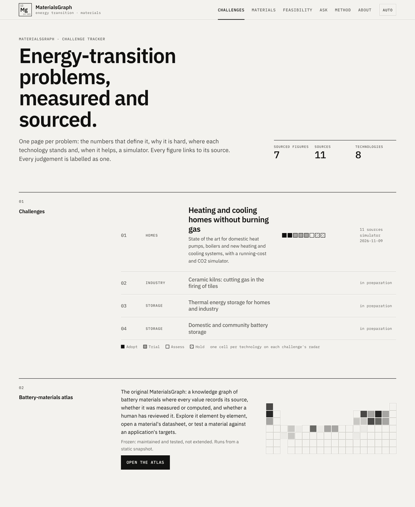
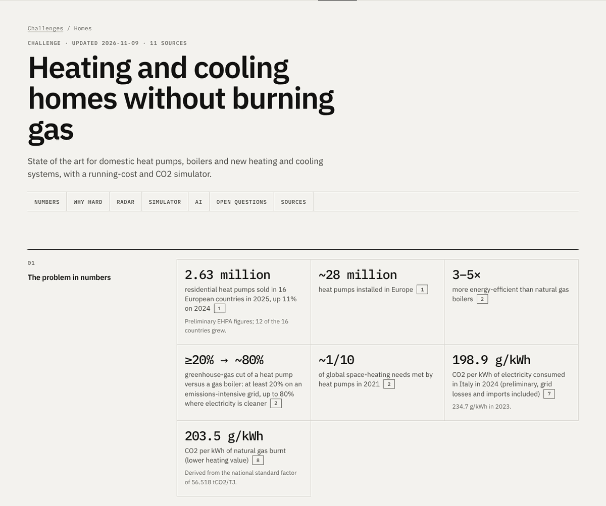
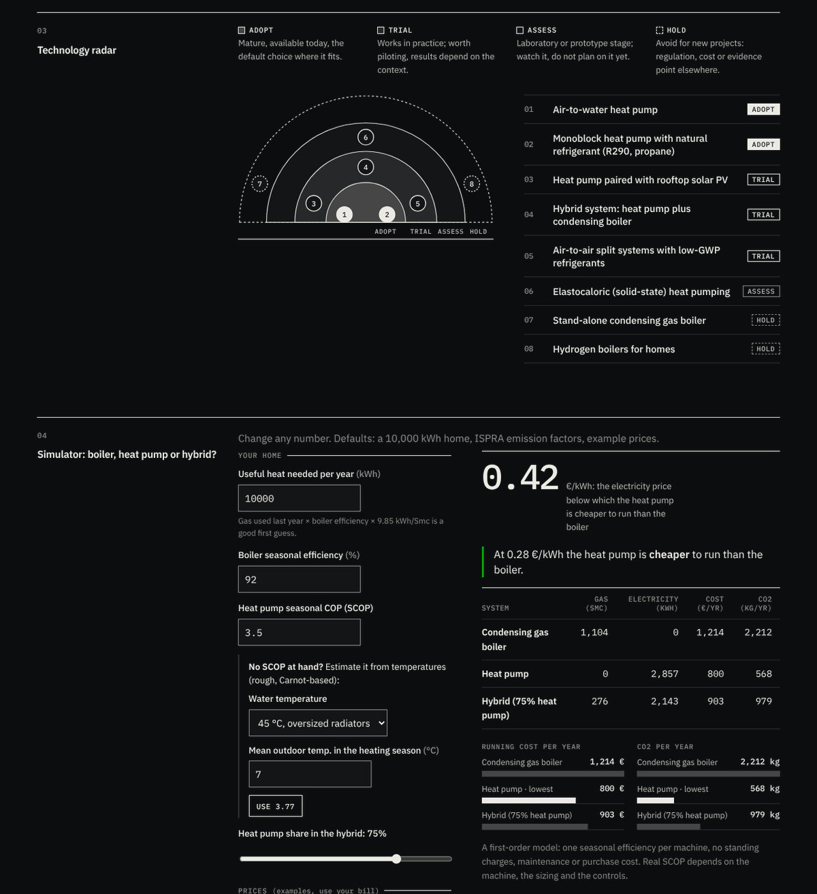
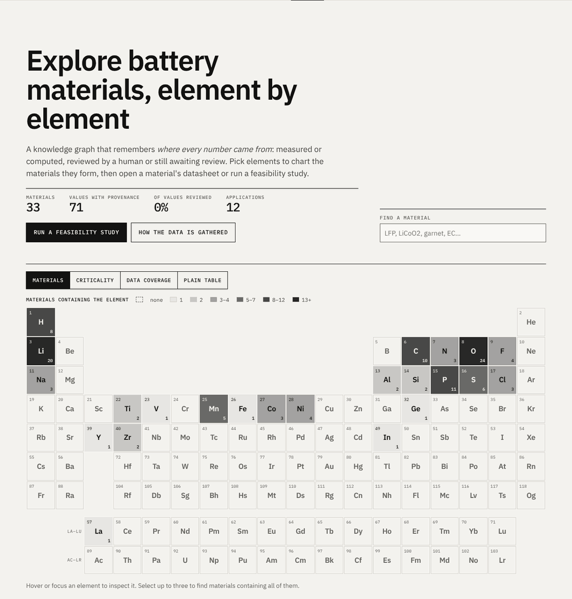
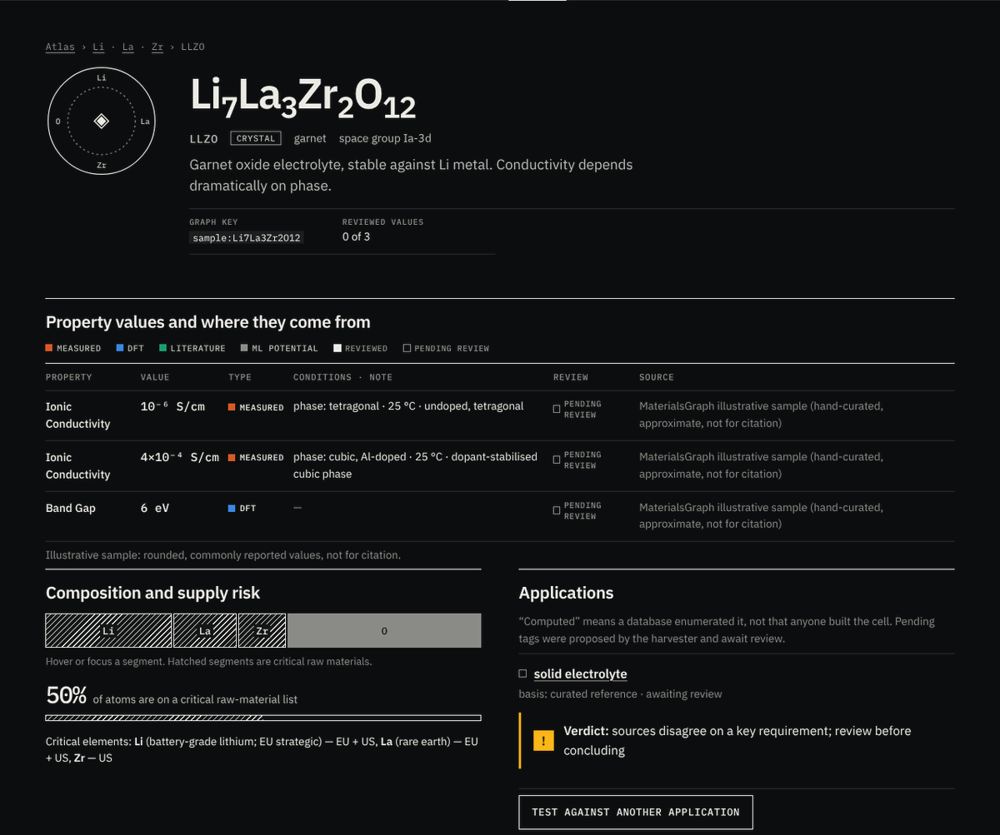
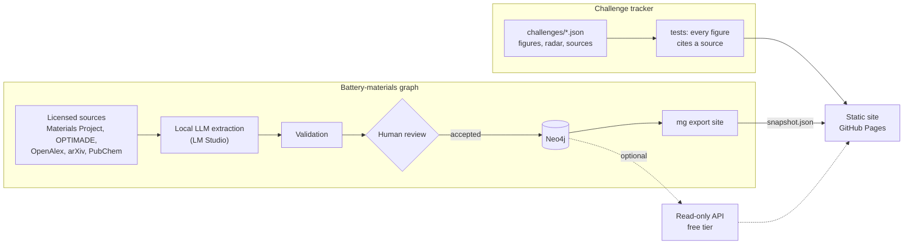

# MaterialsGraph

Energy-transition problems, measured and sourced, plus a knowledge graph of battery materials that remembers
where every number came from.

**Live site: [angelo-casali.github.io/Materialsgraph](https://angelo-casali.github.io/Materialsgraph/)**



## What's inside

| Part | What it does | Status |
|---|---|---|
| **Challenge tracker** | One page per problem: the key figures, why it is hard, a technology radar (Adopt, Trial, Assess, Hold) and, where it helps, a simulator. First challenge: heating homes without burning gas. | Active |
| **Battery-materials atlas** | A periodic table, a datasheet per material and feasibility checks against an application's targets. Every value records its source, whether it was measured or computed, and whether a human reviewed it. | Frozen: maintained, not extended |

Two rules hold everywhere: every figure links to a source, and every judgement or machine suggestion is
labelled as such.

## A closer look

| A challenge page | Radar and simulator (dark theme) |
|---|---|
|  |  |
| **The materials atlas** | **A material datasheet (dark theme)** |
|  |  |

## How it fits together



The site works entirely from static files. The optional API only adds free-text questions on the Ask page.

## Run it

Website (Node 22):

```bash
cd web
npm install
npm run dev          # http://localhost:5173/Materialsgraph/
npm test             # unit tests, including the challenge sourcing rules
npm run build        # type-check, build and performance budget
npx playwright test  # every page, desktop and phone, light and dark, accessibility scans
```

Graph pipeline (Python 3.11, Neo4j in Docker, LM Studio): see [docs/graph.md](docs/graph.md).

```bash
pip install -e ".[dev]"
docker compose up -d
mg schema apply
pytest -q
```

## Contribute a challenge

A challenge is one JSON file in `web/src/data/challenges/`. Every figure and technology cites a source, and the
tests fail when one does not. Steps and rules: [docs/challenges.md](docs/challenges.md).

## Deploy for free

GitHub Pages hosts the site. The optional live API runs on Vercel Hobby with Neo4j AuraDB Free and a free
hosted model. No card on file, so the bill stays at zero. Steps: [docs/deploying.md](docs/deploying.md).

## Repository map

```
web/          the site: Vite, TypeScript, Preact; challenge data in web/src/data/challenges/
src/          Python package: ingestion, harvester, graph writers, GraphRAG query layer, `mg` CLI
api/          read-only FastAPI service for the optional live Ask page
docs/         design decisions, challenge rules, deployment, the graph pipeline
tests/        pytest suites, shared fixtures (the site's engine is parity-tested against them)
```

## Design notes

The site uses a datasheet style: ink on paper, 1px rules, IBM Plex Sans for text and IBM Plex Mono for
numbers. Colour appears only where it carries data, such as source types, verdicts and simulator results. The
data palette is checked for colour-blind separation. Every colour cue also has a text label.
